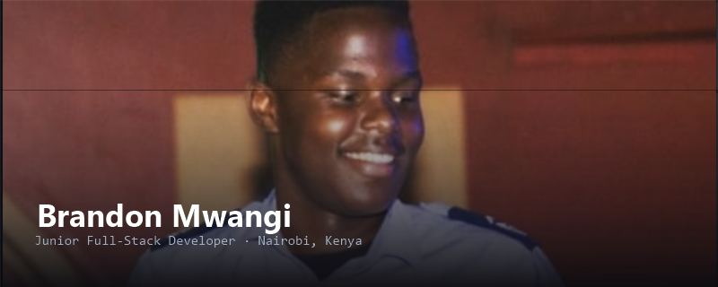

 

 

## About

Hi, I’m Brandon Mwangi — a Junior full-stack developer based in Nairobi, Kenya, focused on building modern, scalable, and user-centered web experiences.

I work across the stack with a strong focus on TypeScript, Next.js, React, and clean product engineering. My interest is in turning complex problems into simple, reliable, and high-impact digital products.

I enjoy building interfaces that feel intuitive, writing code that is easy to maintain, and creating solutions that balance technical quality with real business value.

I’m currently open to internships, junior developer roles, and freelance opportunities where I can contribute, learn quickly, and build meaningful software.

> I care about thoughtful engineering, product quality, and building software that users trust.

 

## What I Do

- Build responsive, accessible frontend experiences with React and Next.js
- Develop backend logic and application flows with a product mindset
- Translate business requirements into simple, maintainable technical solutions
- Create polished interfaces that prioritize usability, speed, and clarity
- Collaborate effectively through clear communication and structured problem solving

 

## Core Strengths

- Frontend development with React and Next.js
- Responsive and accessible UI implementation
- Full-stack product thinking from concept to delivery
- Maintainable code architecture and clean component design
- Clear communication, ownership, and delivery discipline

 

## Tech Stack

### Languages

### Frameworks & Tools

 

## Selected Projects

| Project | What it does | Stack |
|---|---|---|
| **[House Rental Site](https://github.com/MuraguriBrandon/HOUSE-RENTAL-SITE)** | Property listing and rental platform focused on search, browsing, and user-friendly discovery | TypeScript, Next.js, React |
| **[Restaurant Website](https://github.com/MuraguriBrandon/Restaurant-Website)** | Responsive restaurant experience with menu browsing and ordering flow | Next.js, TypeScript, JavaScript |
| **[Car Rental](https://github.com/MuraguriBrandon/Car-rental)** | Vehicle booking interface designed for smooth browsing and quick reservation journeys | HTML, CSS, JavaScript |
| **[Carwash Project](https://github.com/MuraguriBrandon/carwash-project)** | Service listing and booking website for a local business with user-first flow | HTML, CSS, JavaScript |
| **[RockPaperScissors](https://github.com/MuraguriBrandon/RockPaperScissors)** | Interactive Java game focused on logic, control flow, and UI patterns | Java |
| **[MLSA Training](https://github.com/MuraguriBrandon/my-MLSA-training-)** | Coursework and project work from the Microsoft Learn Student Ambassador program | Various |

> I build practical, end-to-end projects that combine clean engineering with product thinking and real user value.

 

## Work Principles

- Simplicity first — I prefer solutions that are clear, maintainable, and easy to evolve.
- User-centered design — software should be intuitive, accessible, and genuinely useful.
- Quality over shortcuts — thoughtful implementation matters as much as speed.
- Ownership and communication — I value clarity, accountability, and consistent progress.
- Continuous learning — every project is an opportunity to improve technically and professionally.

 

## Experience & Approach

- I build with clarity and purpose, always aiming to solve the right problem effectively.
- I structure code to remain understandable, maintainable, and scalable over time.
- I communicate early and keep feedback loops tight when requirements evolve.
- I focus on both product value and engineering quality in every build.
- I’m committed to learning continuously and improving both technical and collaborative skills.

 

## GitHub Activity

  

 

  

 

## Let’s Connect

I’m open to internships, junior developer positions, freelance work, and collaborative opportunities. If you’re building something impactful and need a developer who values clean execution, product thinking, and steady growth, I’d love to connect.

 

